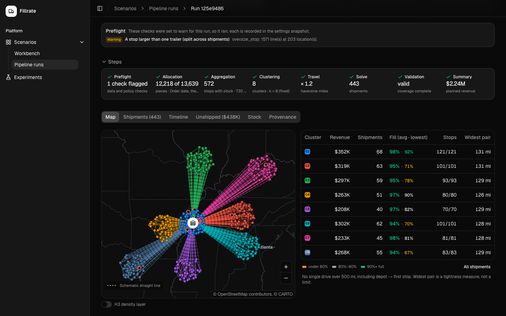
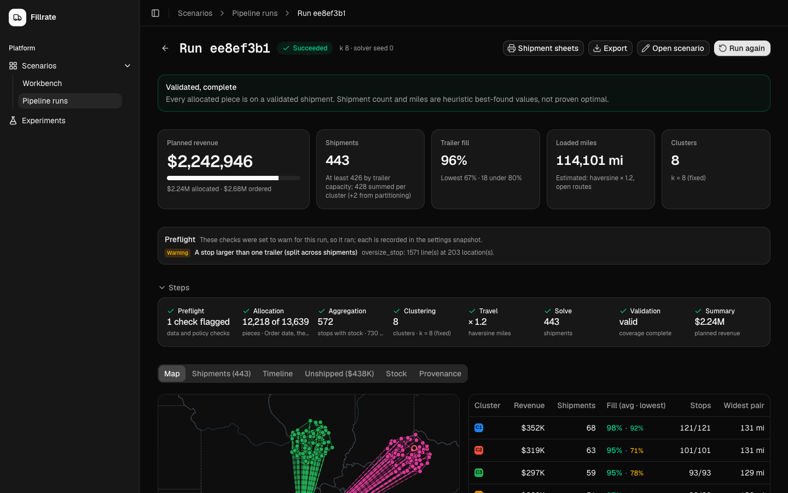
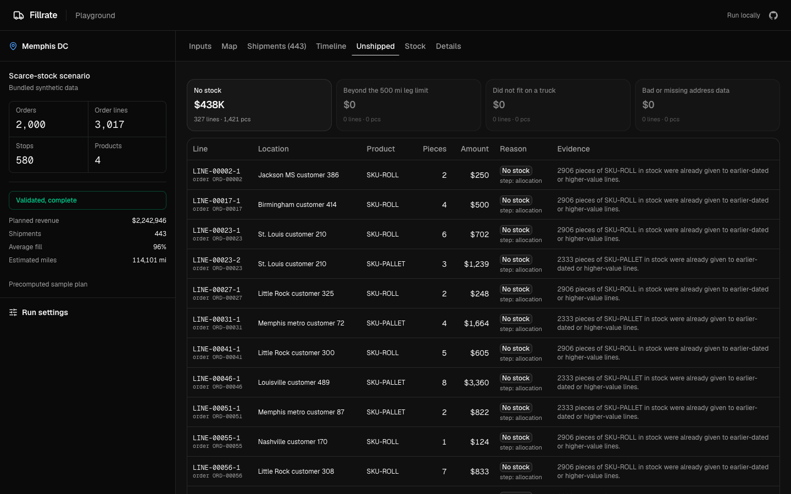
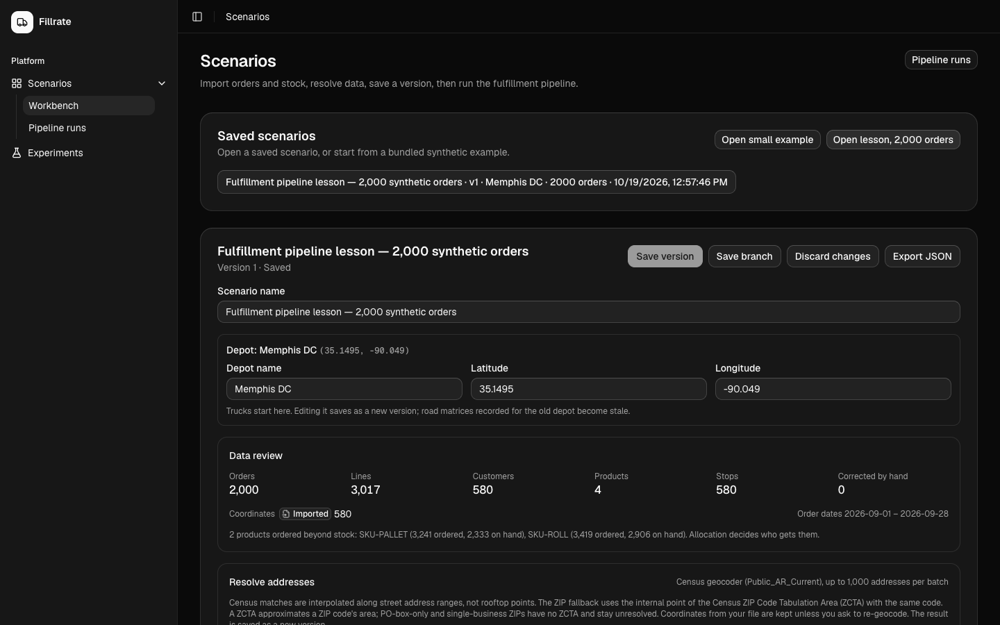
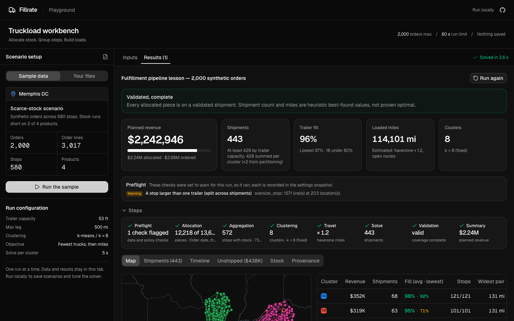

<h1 align="center">Fillrate</h1>

<p align="center">Allocate scarce inventory to open orders and build full truckloads.</p>

<p align="center">
  <a href="https://fillrate.blasingame.dev">Website</a> ·
  <a href="#run-it-locally">Run locally</a> ·
  <a href="https://github.com/timblazing/fillrate/issues">Report an issue</a> ·
  <a href="LICENSE">MIT license</a>
</p>

<p align="center"></p>

When stock is short and trucks are finite, Fillrate answers three questions for a single depot shipping on 53 ft trailers: **which order lines get the stock, how stops group into delivery areas, and how many full trucks it takes.** Every plan is checked by an independent validator and explains why each line did or didn't ship.

## How a run works

1. **Allocate** available inventory to order lines piece by piece: earliest order date first, then highest value per piece. Lines can be partly filled.
2. **Cluster** the stops with k-means. The k explorer compares k values and seeds so you can check a grouping is stable.
3. **Build loads** in each cluster with [PyVRP](https://pyvrp.org/): linear feet as capacity, open routes (no return leg), at most 500 miles per drive, optional delivery time windows. Fewest trucks first, then fewest miles.
4. **Validate and compare.** Revenue, trailer fill, truck count and miles per run, cluster and shipment, with stops counted once even when an oversize stop is split across trucks; side-by-side comparison across runs and sweeps.

Distances are straight-line miles × a circuity factor (default 1.2). Roads never feed the optimizer; you can draw a shipment's road path from the public Valhalla server for display (routing © Valhalla / FOSSGIS, data © OpenStreetMap contributors).

## Screenshots

| | |
|---|---|
|  |  |
| **Run summary.** Headline numbers, preflight checks and each pipeline step. | **Unshipped.** Every line that didn't ship, why, and the evidence. |
|  |  |
| **Workbench.** Open a saved scenario or example, review and fix data, save versions, then run. | **Playground.** The public site: explore a precomputed, validated plan for the sample. |

## Features

- **Import** orders and stock as CSV, GeoJSON points or scenario JSON, or open a bundled example in one click. Once a scenario is open, the import form folds away until you need it. Addresses geocode with the free US Census geocoder, with a labeled ZIP fallback; fix coordinates by hand on a map.
- **Versioned scenarios.** Edit quantities, dates and coordinates in place; each save is a new version you can branch from.
- **Preflight checks** flag missing coordinates, unreachable stops and oversize stops before the solver runs, each set to block or warn.
- **Run inspection.** Cluster map, per-shipment list and timeline, unshipped lines with reasons, stock use and full provenance.
- **Experiments.** Sweep k, seeds and settings across runs and rank the results.
- **Exports.** Printable shipment sheets, JSON, CSV, GeoJSON, and a Python bundle that replays a run with PyVRP.

## Run it locally

Local Fillrate is the full tool: single user, no account, scenarios and runs saved in SQLite. Keep real data here.

**Docker:**

```sh
mkdir -p data
docker run --rm -p 127.0.0.1:3000:3000 \
  -v "$PWD/data:/app/data" ghcr.io/timblazing/fillrate:latest
```

Open http://localhost:3000/scenarios and click **Open lesson, 2,000 orders** to try it. Data is stored in `./data/fillrate.sqlite`.

**From source** (Node 24, [Bun](https://bun.sh), [uv](https://docs.astral.sh/uv/) with Python 3.13):

```sh
bun install
(cd services/optimizer && uv sync)
bun run dev                       # terminal 1: http://localhost:3000
bun run optimizer                 # terminal 2: the Python solver service (127.0.0.1:8000)
```

## Static public site

`bun run build:static` exports the landing page, privacy page and `/playground` as static files in `apps/web/out`, for any static host. The playground shows the bundled sample plan only; nothing runs on a server.

The playground sample is a bundled solver result, so viewing it does not run the optimizer. After changing the example, optimizer, or its dependency lock, regenerate it with `cd services/optimizer && uv run python ../../examples/generate-playground.py`. Tests reject stale sample results.

## Limits

Fillrate is a planning and comparison tool, not dispatch, tracking or navigation. Linear feet are a one-dimensional capacity model, not a packing or compliance check. Allocation is an experiment against an inventory snapshot, not a reservation. Shipment counts and miles are the solver's best found values, not proven optimal.

Built with Next.js, SQLite, Python and PyVRP. Contributors and coding agents, see [`AGENTS.md`](AGENTS.md).

## License

[MIT](LICENSE)
